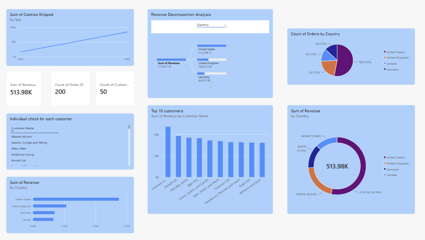

# Sales Performance & Customer Insights Dashboard

An interactive sales analytics dashboard built with **Microsoft Power
BI**. The report provides an overview of revenue, order activity,
customer performance, and geographical sales distribution across four
countries.



## Project Overview

This project explores sales data by combining customer information with
order-level records. The dashboard is designed to help users quickly
monitor key performance indicators, compare country-level results,
identify high-value customers, and examine changes in sales activity
over time.

## Dashboard Highlights

### Key Performance Indicators

The dashboard reports the following headline metrics:

  KPI                 Dashboard result
  ----------------- ------------------
  Total Revenue                513.98K
  Total Orders                     200
  Total Customers                   50

### Sales and Shipping Trends

-   **Cookies Shipped by Year:** compares the number of cookies shipped
    in 2024 and 2025.
-   **Revenue by Year:** tracks annual revenue across 2024 and 2025.

### Country-Level Analysis

-   **Orders by Country:** shows each country's share of total orders.
-   **Revenue by Country:** compares revenue across the United States,
    United Kingdom, Germany, and Canada.
-   **Revenue Share by Country:** presents each country's contribution
    to total revenue.

### Customer Analysis

-   **Top 10 Customers:** ranks the ten highest-revenue customers.
-   **Individual Customer Check:** provides a customer-name list for
    reviewing individual customer records.

## Data Model

The report uses two tables connected through `Customer ID` in a
one-to-many relationship:

  -----------------------------------------------------------------------
  Table                               Fields
  ----------------------------------- -----------------------------------
  `Customers`                         Country, Customer ID, Customer Name

  `Orders`                            Cookies Shipped, Customer ID, Order
                                      Date, Order ID, Revenue
  -----------------------------------------------------------------------

**Relationship:** `Customers[Customer ID]` (one) → `Orders[Customer ID]`
(many).

The customer table provides descriptive attributes, while the orders
table contains transaction-level measures used in the report.

## Tools and Skills

-   Microsoft Power BI
-   Data modeling and table relationships
-   Data visualization and dashboard design
-   KPI reporting
-   Filtering, sorting, and Top N analysis
-   Time-based and geographical sales analysis

## Repository Contents

A suggested repository structure:

``` text
Sales-Performance-Customer-Insights/
├── README.md
├── Sales_Dashboard.pbix
├── Dashboard_Overview.png
└── Dashboard_Report.pdf
```

Add the `.pbix` file and optional PDF export when publishing the
project. The screenshot in this repository should be saved as
`Dashboard_Overview.png` for the preview above to display.

## Notes

-   The KPI values shown in this README reflect the dashboard screenshot
    and may change if the report is refreshed or filtered.
-   The report uses the dataset fields listed in the Data Model section.
-   Before making the repository public, make sure the source data is
    permitted for redistribution and does not contain confidential or
    personally identifiable customer information. If necessary, replace
    real customer names or other sensitive values with anonymized or
    synthetic data.

## How to View the Dashboard

1.  Download `Sales_Dashboard.pbix` from this repository.
2.  Open the file using **Power BI Desktop**.
3.  Refresh the data only if you have access to the original data
    source.

------------------------------------------------------------------------

*Created with Microsoft Power BI.*
